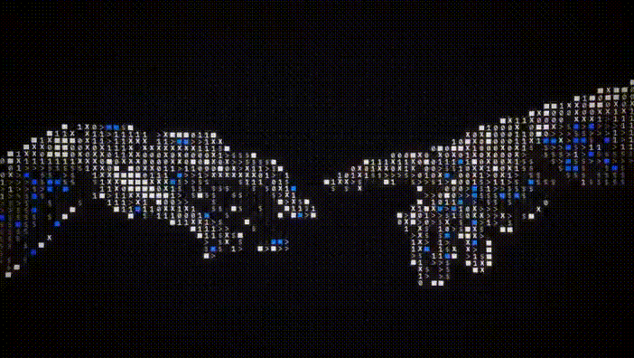

  

 

<h3></h3>
I’m a cybersecurity student, developer, and designer from Indian Institute of Information Technology, Kottayam,
Exploring how things work from the systems beneath the surface to the details that make an interface feel right.

<h2></h2>

<small><strong>Languages &amp; web foundations</strong></small>

  
  
  
  
  
  
  

<small><strong>Frontend frameworks &amp; styling</strong></small>

  
  
  
  

<small><strong>Backend &amp; databases</strong></small>

  
  
  
  
  
  
  
  

<small><strong>Design &amp; development tools</strong></small>

  
  
  

<h2></h2>

  

